<div align="center">


# MealDeal

**Turn your budget and this week's grocery prices into meals you can actually make.**

A mobile-first web app for students in Vancouver: plan meals from real flyer prices, shop one list,
cook step by step, grab end-of-day food for less, and find free food support nearby.

[**Live app →**](https://mealdeal-beta.vercel.app) &nbsp;·&nbsp; [Design system](docs/DESIGN.md) &nbsp;·&nbsp; [Architecture](docs/ARCHITECTURE.md)


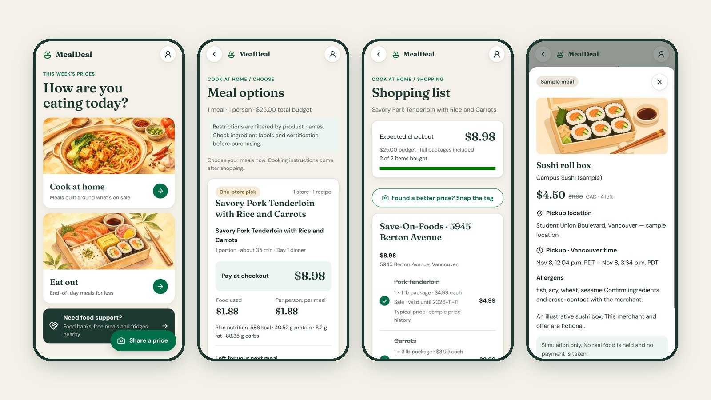

</div>

---

## Contents

- [Why MealDeal](#why-mealdeal)
- [What you can do](#what-you-can-do)
- [How we use each tool](#how-we-use-each-tool)
- [Architecture](#architecture)
- [Run it locally](#run-it-locally)
- [Project structure](#project-structure)
- [Testing and CI](#testing-and-ci)
- [Privacy and safety](#privacy-and-safety)
- [Team](#team)

## Why MealDeal

Eating well on a student budget means juggling flyers, recipes, a half-empty fridge and a bus schedule.
Most recipe apps ignore prices; most deal apps ignore what you can cook. MealDeal joins them:

- **Real prices, not guesses.** Plans are priced from this week's flyers at stores near you, using full packages
  (you can't buy 80 g of rice), minus what is already in your pantry.
- **AI where it helps, code where it matters.** Gemini reads price tags and writes recipes. Code checks every
  product ID and works out every dollar, gram and calorie.
- **More than cooking.** If cooking isn't an option today, Eat Out finds discounted end-of-day meals, and Food support
  lists food banks, free meals and community fridges.

## What you can do

### 1 · Set up your kitchen once

Six short steps: units, food rules (diet, allergies, how many people), equipment, pantry, shopping range and an
optional nutrition goal. Custom choices are allowed and checked (see [Privacy and safety](#privacy-and-safety)).

<table>
  <tr>
    <td width="33%">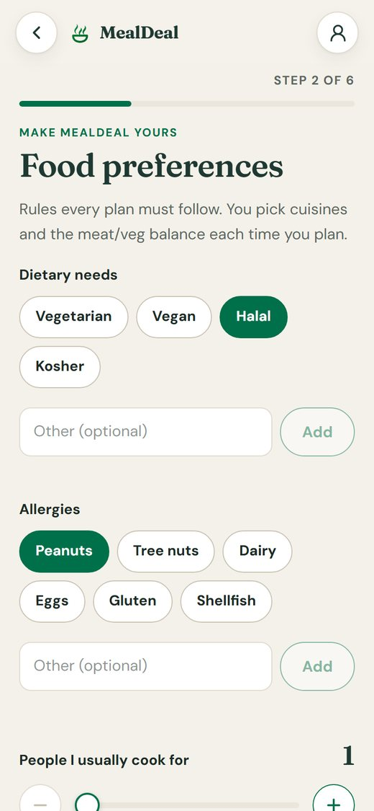</td>
    <td width="33%">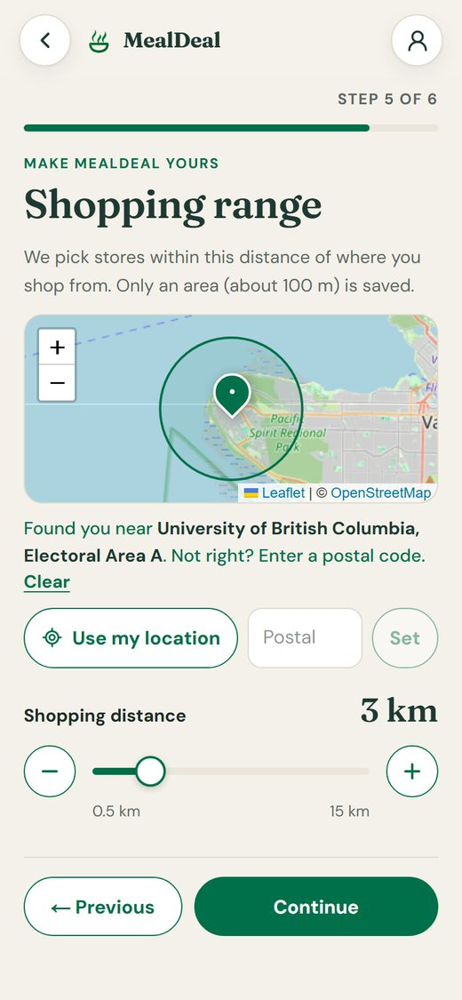</td>
    <td width="33%">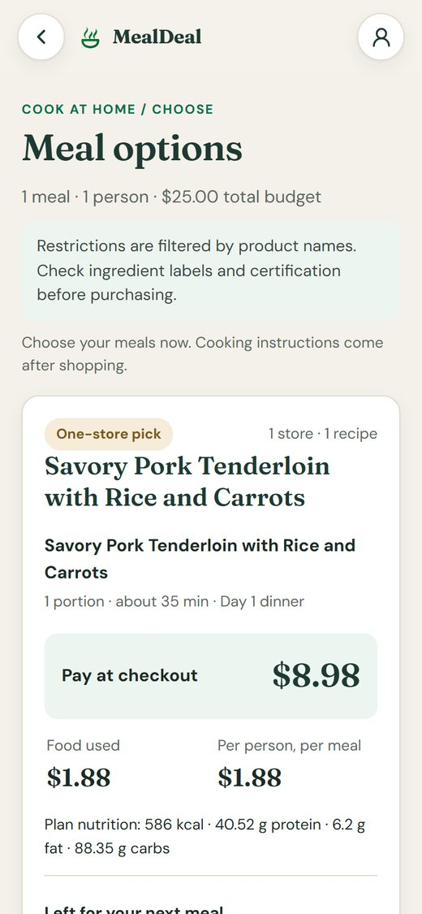</td>
  </tr>
  <tr>
    <td align="center"><sub><b>Food preferences.</b> Rules every plan follows.</sub></td>
    <td align="center"><sub><b>Shopping range.</b> Use my location or a postal code; the circle shows the distance.</sub></td>
    <td align="center"><sub><b>Meal options.</b> Checkout price, cost per meal and nutrition.</sub></td>
  </tr>
</table>

### 2 · Plan, shop, cook

Pick a budget, people, one meal or 1–7 days, cuisines and cooking time. MealDeal returns complete options that fit the
budget, a shopping list grouped by store, and a step-by-step cooking mode with timers that remembers where you were.

<table>
  <tr>
    <td width="33%">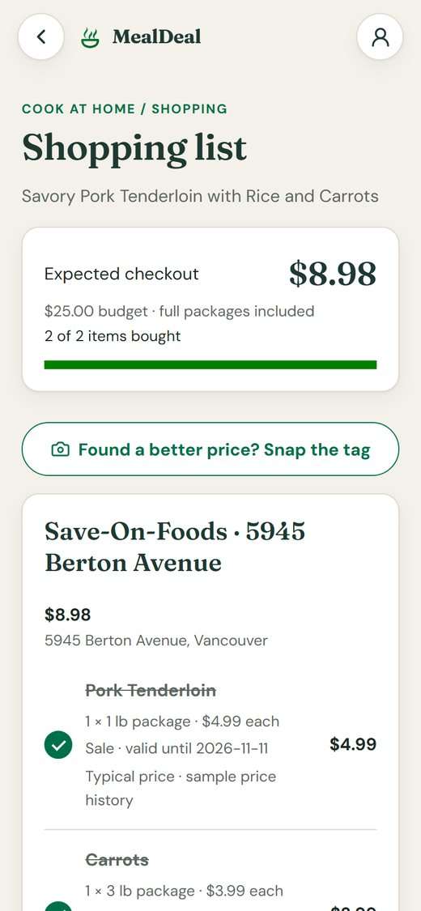</td>
    <td width="33%">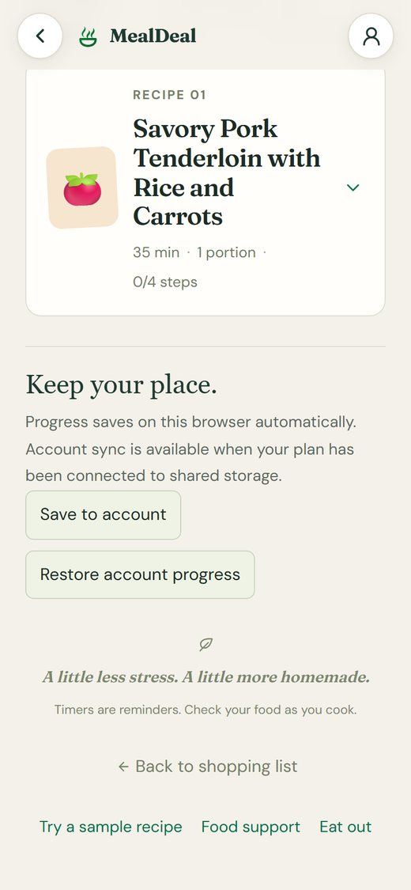</td>
    <td width="33%">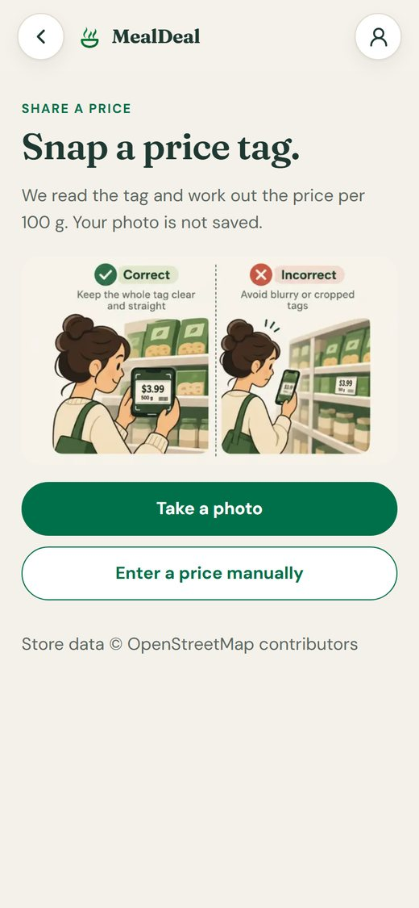</td>
  </tr>
  <tr>
    <td align="center"><sub><b>Shopping list.</b> Tick items off; sales show whether they are a real deal.</sub></td>
    <td align="center"><sub><b>Cooking mode.</b> One step at a time, progress saved.</sub></td>
    <td align="center"><sub><b>Share a price.</b> Snap a tag; Gemini reads it, code does the math.</sub></td>
  </tr>
</table>

### 3 · Eat out for less, or get support

<table>
  <tr>
    <td width="33%">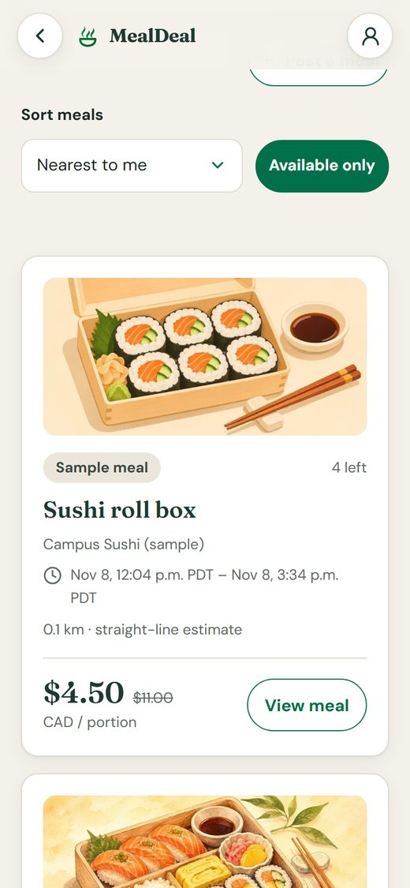</td>
    <td width="33%">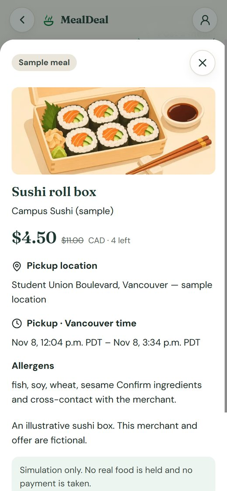</td>
    <td width="33%">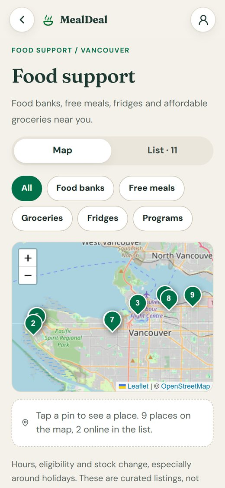</td>
  </tr>
  <tr>
    <td align="center"><sub><b>Eat Out.</b> End-of-day meals within your pickup distance.</sub></td>
    <td align="center"><sub><b>Meal details.</b> Pickup window, allergens, reserve one portion.</sub></td>
    <td align="center"><sub><b>Food support.</b> Food banks, free meals and fridges on a map.</sub></td>
  </tr>
</table>

> Eat Out uses clearly labelled sample merchants: reservations are simulated and no real food is held.

## How we use each tool

| Tool | What it does in MealDeal | Where |
| --- | --- | --- |
| **Next.js 16** (App Router, Turbopack) | One app for pages and API routes. Server components render the shell; client components handle the multi-step forms. Route handlers stay thin and call feature modules. Icons and the web manifest are generated with `next/og`. | `src/app/` |
| **Auth0** (`@auth0/nextjs-auth0` v4) | Log in with Auth0 to save your kitchen, pantry, meal plans and cooking progress to your account, and to share prices. The session is validated on the server; the browser never sees tokens. Without Auth0 (local development) a labelled demo identity is used; production always requires Auth0. | `src/lib/auth0.ts`, `src/lib/session.ts` |
| **Tiger Data** (PostgreSQL + TimescaleDB) | Stores users, pantries, saved meal plans, cooking progress, stores, products and surplus listings. Every flyer import and confirmed price report is a row in the `price_observations` **hypertable**, which powers the deal check: is today's price per 100 g at least 10% below the 28-day median at the same store? One server-only connection pool; migrations are plain, ordered SQL files. | `src/lib/db.ts`, `db/migrations/`, `src/features/catalog/deal.ts` |
| **Google Gemini** | Four narrow jobs, each with a JSON schema and validation: **(1)** read the text on a price-tag photo, **(2)** compose recipes using only catalog product IDs we provide, **(3)** label flyer products with a category and match them to a nutrition record, **(4)** decide whether a custom diet, allergy, tool or pantry item is a real food term. Gemini never sets prices, quantities or nutrients. Models are tried cheapest first (Flash-Lite, then Flash) and plans are retried with the validation errors if a draft breaks a rule. | `src/features/planning/gemini.ts`, `src/features/catalog/extract.ts`, `src/lib/choice-model.ts` |
| **Vercel** | Hosting. Every push to `main` deploys to production; every pull request gets a preview URL. Secrets live in Vercel environment variables. | [mealdeal-beta.vercel.app](https://mealdeal-beta.vercel.app) |
| **OpenStreetMap** · Leaflet · Nominatim | Map tiles and pins (Leaflet, no API key) for shopping range, Eat Out and Food support. Nominatim finds nearby stores, turns a postal code into an area and names the area for "Use my location". | `src/features/support/support-map.tsx`, `src/features/catalog/geocode.ts` |
| **Flipp flyers** | This week's sale prices for the seeded stores near UBC (Save-On-Foods, No Frills, Urban Fare). A script imports them, normalises sizes and prices with code, and records each price as an observation. | `scripts/build-catalog-seed.mts`, `src/features/catalog/flipp.ts` |
| **USDA FoodData Central** | Nutrition per 100 g for the foods products are matched to. Plan nutrition is calculated by code from these values. | `mock/foods.json`, `src/features/catalog/nutrition.ts` |
| **Zod** | Validates every API input and every Gemini response before it is used. API errors share one shape: `{ error, code, fields? }`. | `src/lib/api-error.ts` |
| **GitHub Actions** | On every pull request and every push to `main`: lint, the four test suites, then a production build. | `.github/workflows/` |

## Architecture

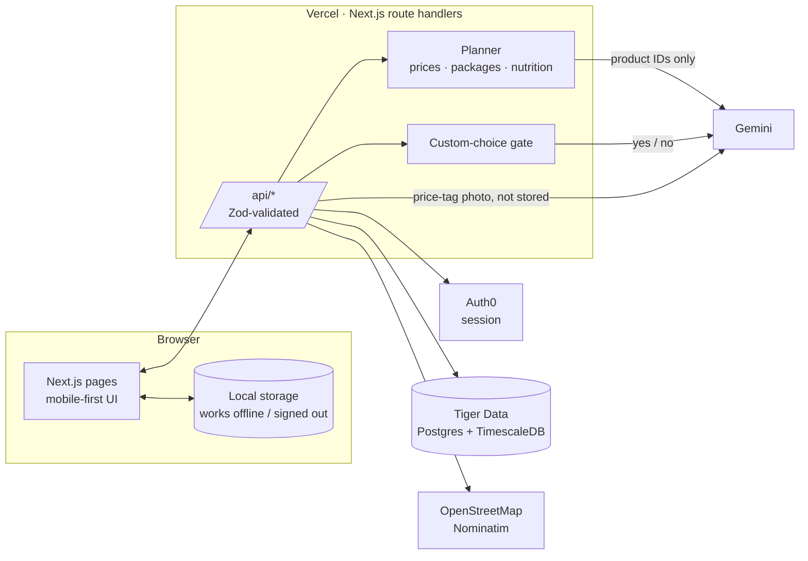

**Planning in one request.** `POST /api/plan` checks custom choices, loads products from stores within your range
(falling back to the nearest stores with a warning), asks Gemini for recipe drafts that may only use those product
IDs, rejects drafts that break a rule, then prices them by code: whole packages, pantry first, budget checked. If
nothing fits, the error says how much the cheapest complete plan costs.

## Run it locally

Requires **Node.js 22.18+**.

```bash
npm install
cp .env.example .env.local   # optional: the app runs in demo mode without any keys
npm run dev                  # http://localhost:3000
```

| Variable | Needed for | Without it |
| --- | --- | --- |
| `AUTH0_DOMAIN`, `AUTH0_CLIENT_ID`, `AUTH0_CLIENT_SECRET`, `AUTH0_SECRET`, `APP_BASE_URL` | Log in and account sync | Local demo identity (not in production) |
| `DATABASE_URL` | Tiger Data (pooled connection string) | Data stays in the browser; catalog comes from `mock/` |
| `GEMINI_API_KEY` | Recipes, price-tag reading, custom-choice checks | Labelled demo templates; custom choices outside the built-in list are refused |
| `GEMINI_PLAN_MODELS`, `GEMINI_CHECK_MODELS` | Override the model order | Cheapest-first defaults |
| `NEXT_PUBLIC_DEMO_MODE` | Set to `0` to turn the local demo identity off | Demo identity on in development |

Set up Auth0 and the database:

1. Create a **Regular Web Application** in Auth0. Callback URL `http://localhost:3000/auth/callback`, logout URL `http://localhost:3000`.
2. Put the pooled Tiger Data connection string in `DATABASE_URL`.
3. Run `npm run db:migrate`, then `npm run db:seed:catalog` to load stores, products and price history.

<details>
<summary><b>All scripts</b></summary>

| Script | What it does |
| --- | --- |
| `npm run dev` / `build` / `start` | Next.js development server, production build, production server |
| `npm run lint` | ESLint |
| `npm run db:migrate` | Apply `db/migrations/*.sql` in order |
| `npm run seed:catalog` | Rebuild `mock/stores.json` and `mock/products.json` from OpenStreetMap and Flipp |
| `npm run seed:foods` | Match products to nutrition records |
| `npm run db:seed:catalog` | Load the catalog and price observations into Tiger Data |
| `npm run test:api` · `test:catalog` · `test:planning` · `test:d` | Test suites (see below) |

</details>

## Project structure

```text
src/
  app/            pages and thin API route handlers
  components/     shared UI: top bar, location picker, range slider, brand
  features/
    catalog/      stores, products, flyers, price tags, deal check, nutrition
    planning/     plan form, Gemini planner, pricing, shopping list
    cooking/      cooking mode and saved progress
    surplus/      Eat Out listings, reservations, publishing
    support/      food support resources and map
  lib/            Auth0, database pool, API errors, custom-choice checks
  types.ts        shared contract between features
db/migrations/    ordered SQL migrations
docs/             design system, architecture, feature handoffs
mock/             seeded catalog, nutrition data, sample listings
```

## Testing and CI

```bash
npm run test:api        # API helpers, custom-choice checks
npm run test:catalog    # pricing, flyers, deal check, nutrition matching
npm run test:planning   # planner rules, budgets, pantry, retries
npm run test:d          # cooking sessions, plan storage, Eat Out inventory
```

GitHub Actions runs lint, all four suites and a production build on every pull request and on every push to `main`.

## Privacy and safety

- **Location:** only an area rounded to about 100 m is saved, never an exact position.
- **Photos:** price-tag photos are read and discarded; MealDeal has no image storage.
- **Prompt injection:** custom text (diets, allergies, equipment, goals, pantry items) passes a strict format check and a
  known-food vocabulary. Anything else goes to a small Gemini yes/no check that is cached, rate-limited and **fails
  closed**: if the check is unavailable, the value is refused, not let through.
- **Secrets:** server-only environment variables; nothing is exposed with a `NEXT_PUBLIC_` prefix.
- **Allergens:** restrictions are filtered by product names, and the app always asks you to check labels. Eat Out
  allergen notes say "no allergens declared" rather than "allergen-free".

## Team

Built at **HackCamp 2026** by a team of four:

| | Member | Area | Scope |
| --- | --- | --- | --- |
|  | [@Catherine123185](https://github.com/Catherine123185) | A · Profile and UI | Onboarding, kitchen check, app shell, illustrations and logo |
|  | [@SebastianZzzz](https://github.com/SebastianZzzz) | B · Price data · lead | Stores, flyers, price tags, deal check, nutrition, location |
|  | [@Donowark](https://github.com/Donowark) | C · Planning | Plan form, Gemini planner, pricing, shopping list, saved plans |
|  | [@peiyao121](https://github.com/peiyao121) | D · Cooking and community | Cooking mode, Eat Out, Food support |

See [CONTRIBUTING.md](CONTRIBUTING.md) for the branch and PR workflow. Released under the [MIT License](LICENSE).
