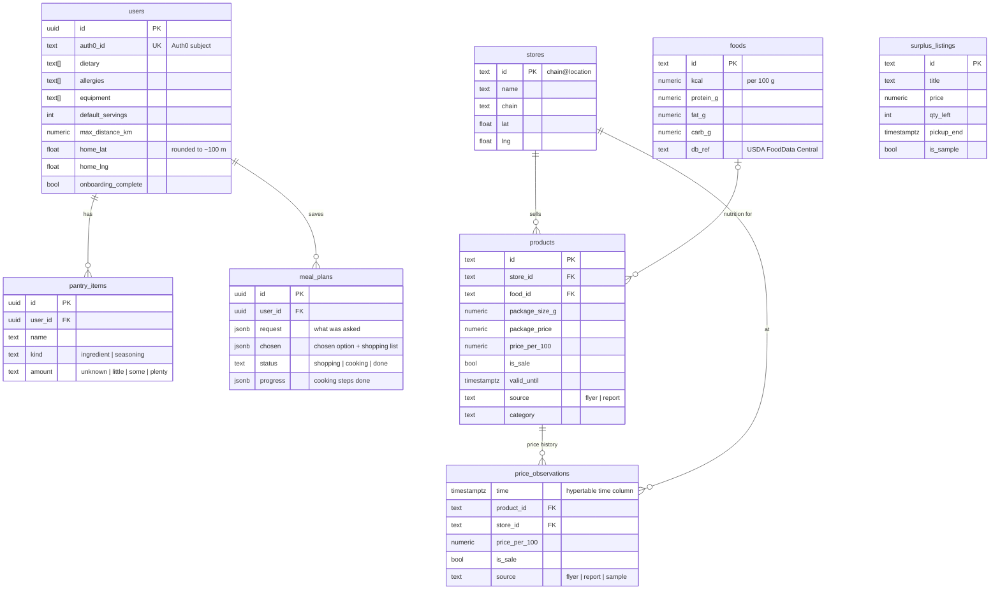

# Database and data flow

MealDeal stores everything in one **Tiger Data** service: PostgreSQL with the **TimescaleDB** extension.
The browser never connects to it. All access goes through server route handlers and one pooled client
(`src/lib/db.ts`), after the Auth0 session has been checked.

- [Schema](#schema)
- [Data flows](#data-flows)
- [Key queries](#key-queries)
- [Code map](#code-map)
- [Run and inspect](#run-and-inspect)

## Schema



| Table | Holds | Notes |
| --- | --- | --- |
| `users` | One row per Auth0 account: units, diet rules, equipment, distance, shopping area, nutrition goal | Upserted on `auth0_id`. Check constraints guard servings (1–20), distance (0.5–50 km) and coordinates. |
| `pantry_items` | What the user already has | Replaced as a whole in one transaction on save. |
| `meal_plans` | Chosen plan, shopping list, cooking progress | JSONB documents, versioned by comparison (see optimistic updates below). |
| `stores` | Grocery stores near UBC from OpenStreetMap | IDs look like `save-on-foods@berton-avenue`. |
| `products` | Current price of each product at each store | `price_per_100` is computed by code from package size and price. |
| `foods` | Nutrition per 100 g (USDA FoodData Central) | Products link to a food so plans can compute nutrition. |
| `price_observations` | **Every price we have ever seen**: flyer imports, confirmed community reports, labelled samples | **TimescaleDB hypertable** partitioned on `time`. Unique on `(product_id, source, time)` so re-imports never double count. Indexed on `(product_id, time desc)` for history lookups. |
| `surplus_listings` | Eat Out meals | Partial index on `(pickup_end, price) where qty_left > 0` for the available list. |
| `food_resources` | Food support places | The app currently ships these as curated data in `src/features/support/resources.ts`. |

Migrations: [`db/migrations/`](../db/migrations), applied in filename order. Each file runs once; applied files are recorded in `schema_migrations`.

## Data flows

### 1 · Catalog: flyers → products → price history

```text
OpenStreetMap (Nominatim) ─► stores near UBC ─┐
Flipp flyers ─► code parses size & price ─────┼─► mock/*.json ─► npm run db:seed:catalog ─► stores, products, foods
Gemini: category + nutrition match ───────────┘                                         └─► price_observations (source = flyer / sample)
```

Gemini only labels a product's category and picks a nutrition record from our list. It never sees or sets prices.

### 2 · Share a price: photo → product + observation

```text
photo ─► POST /api/extract/price-tag ─► Gemini copies the printed text ─► code parses size/price ─► user confirms
      ─► POST /api/products (login required) ─► one transaction: upsert products + insert price_observations (source = report)
```

The photo is never stored.

### 3 · Deal check: is this sale real?

For a product on sale, read its observations at the same store over the last **28 days**. With at least 3, compare
today's `price_per_100` with their **median**: 10% or more below is a real deal, within 10% is a typical price.
Pure code (`deal.ts`), no AI.

### 4 · Planning: profile + nearby products → priced plan

```text
users (rules, equipment, home, distance) + pantry_items
  ─► stores within max_distance_km of home (nearest stores, with a warning, if none)
  ─► products at those stores, still valid (valid_until)
  ─► Gemini drafts recipes using only those product IDs
  ─► code validates IDs and rules, buys whole packages, uses pantry first, checks budget, sums nutrition from foods
```

The chosen option is saved to `meal_plans` (`POST /api/meal-plans`) for signed-in users and in the browser for everyone.

### 5 · Shopping and cooking: optimistic updates

Ticking items and saving cooking steps update the `meal_plans` row only if it still matches what this device last
read. If another device changed it, the update matches no row and the API returns `409 CONFLICT` with a message,
instead of silently overwriting.

### 6 · Eat Out reservation: no overselling

One conditional `UPDATE … WHERE qty_left > 0` reserves a portion. Two people tapping the last portion at once
cannot both succeed.

## Key queries

**Nearby, still-valid products** (`selectProducts`, `src/features/catalog/catalog-sql.ts`):

```sql
select * from products
where ($1::text[] is null or store_id = any($1))          -- stores within range
  and ($2::text is null or category = $2)
  and ($3::boolean or valid_until is null or valid_until >= $4)   -- drop expired flyer prices
order by id;
```

**Record a price and its history atomically** (`recordPrice` → `insertObservation`):

```sql
begin;
  -- upsertProduct: insert ... on conflict (id) do update (current price)
  insert into price_observations (time, product_id, store_id, package_price, price_per_100, is_sale, source)
  values ($1, $2, $3, $4, $5, $6, $7)
  on conflict (product_id, source, time) do nothing;
commit;
```

**Price history for the deal check** (`selectHistory`; uses `price_observations_product_time_idx`):

```sql
select time, price_per_100, source from price_observations
where product_id = $1 and time >= $2 and time < $3   -- [now - 28 days, now)
order by time;
```

**Save shopping progress without overwriting another device** (`src/app/api/meal-plans/[id]/route.ts`):

```sql
update meal_plans set chosen = $2::jsonb, status = $3, updated_at = now()
where id = $1 and chosen = $4::jsonb and progress = $5::jsonb and status = $6   -- unchanged since read
  and user_id in (select id from users where auth0_id = $7)                    -- only your own plan
returning ...;
```

**Reserve one Eat Out portion** (`src/features/surplus/repository.ts`):

```sql
update surplus_listings set qty_left = qty_left - 1
where id = $1 and qty_left > 0 and pickup_end > clock_timestamp()
returning *;
```

**Replace the pantry in one transaction** (`src/app/api/pantry/route.ts`): `begin` → find the user by `auth0_id` →
`delete from pantry_items where user_id = $1` → insert each item → `commit` (rollback on any error).

Every query is parameterised (`$1`, `$2`, …); user text is never concatenated into SQL.

## Code map

| What | Where |
| --- | --- |
| Connection pool (server only) | `src/lib/db.ts` |
| Auth0 session → identity | `src/lib/session.ts` |
| Profile read/upsert | `src/app/api/me/route.ts` |
| Pantry read/replace | `src/app/api/pantry/route.ts` |
| Stores, products, price history SQL | `src/features/catalog/catalog-sql.ts` |
| Store distance filtering | `src/features/catalog/repo.ts`, `src/features/catalog/nearby.ts` |
| Deal check | `src/features/catalog/deal.ts`, `src/features/catalog/deal-check.ts` |
| Share a price | `src/app/api/extract/price-tag/route.ts`, `src/app/api/products/route.ts` |
| Planning service | `src/features/planning/service.ts`, `src/app/api/plan/route.ts` |
| Saved plans | `src/app/api/meal-plans/route.ts`, `src/app/api/meal-plans/[id]/route.ts` |
| Cooking progress | `src/features/cooking/repository.ts`, `src/app/api/cooking/[id]/route.ts` |
| Eat Out listings and reservations | `src/features/surplus/repository.ts`, `src/app/api/surplus/` |
| Migrations runner | `scripts/migrate.mjs` |
| Catalog build and load | `scripts/build-catalog-seed.mts`, `scripts/match-foods.mts`, `scripts/load-catalog-seed.mts` |

## Run and inspect

```bash
# 1. Point at your Tiger Data service (pooled connection string) in .env.local
DATABASE_URL=postgres://...

# 2. Create the schema (each migration runs once, tracked in schema_migrations)
npm run db:migrate

# 3. Load stores, products, nutrition and price history
npm run db:seed:catalog

# Optional: rebuild the catalog from live OpenStreetMap + Flipp data first (needs GEMINI_API_KEY)
npm run seed:catalog && npm run seed:foods
```

Inspect with `psql "$DATABASE_URL"`:

```sql
-- the hypertable is registered
select hypertable_name, num_chunks from timescaledb_information.hypertables;

-- where prices come from
select source, count(*) from price_observations group by source;

-- weekly median price per 100 g for one product (TimescaleDB time_bucket)
select time_bucket('7 days', time) as week,
       percentile_cont(0.5) within group (order by price_per_100) as median_per_100
from price_observations
where product_id = '<product-id>'
group by week order by week;
```

Without `DATABASE_URL` the app still runs: profile, pantry and plans stay in the browser, and the catalog is read
from `mock/`.
